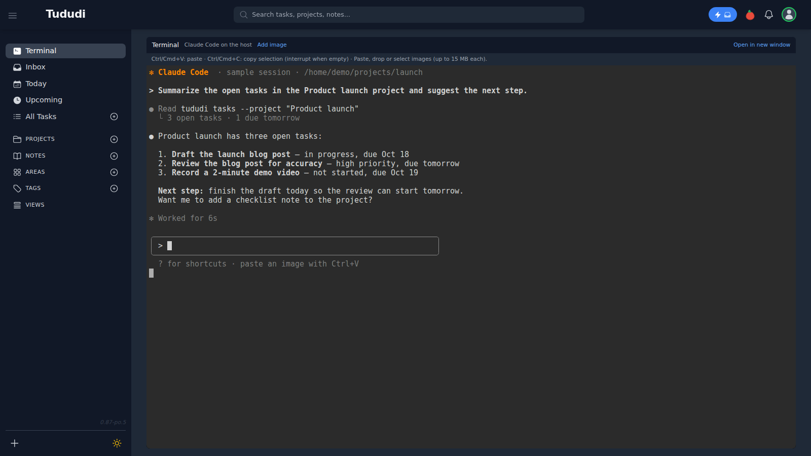

# Tududi — mrekinci edition

**English** | [Türkçe](README.tr.md)

`pixel-office-tududi` is an independent fork of Tududi v0.87. The package and Docker image version is `0.87-po.5`; the application remains **Tududi**.

[Pixel Office](https://github.com/mrekinci-com/pixel-office) stores its agents' tasks, projects, and notes in this application. [This repository](https://github.com/mrekinci-com/pixel-office-tududi) contains the task management application; the office dashboard and agent runners live in the separate Pixel Office project. It also works as a standalone task manager. The original project is [Chris Veleris / Tududi](https://github.com/chrisvel/tududi).

## Screenshots

Sample data only.




Terminal uses simulated sample output here; no host CLI was started for this screenshot.

## Changes from upstream

- A 90-day upcoming task window, monthly calendar and agenda views, project filtering, and drag-to-reschedule dates.
- Day headings and task dates follow the application language and the user's time zone.
- Note sorting, with newest notes first by default in project notes.
- Confirmation before completing or reopening a task through its completion ring.
- Password-only updates through the administrator API are persisted to the database.
- Partial task updates preserve status: editing only the name, note, or date does not reopen a completed task.
- The notification bell shows unread items and their read state correctly. Fixes cover notifications for completed, archived, or deleted tasks and rescheduled reminders.
- An optional, provider-independent external panel identity gate, compatible with Pixel Office's private access behavior.
- An optional Terminal for Claude Code or Codex, with authenticated proxy, clipboard and image transfer.
- An edition-specific About page with English and Turkish translations.

The personal terminal configuration and branding have been removed. A generic, optional Terminal is available with your own host setup; see below. The existing data model, administrator API, API keys, and task/note/project endpoints are preserved. See the [compatibility contract](docs/PIXEL-OFFICE-COMPATIBILITY.md) for the integration details.

## Docker setup

Build the Node.js 22 image from this repository:

```sh
docker build -t pixel-office-tududi:0.87-po.5 .
cp .env.example .env
openssl rand -hex 64
```

Change the administrator email and password in `.env`. Set `TUDUDI_SESSION_SECRET` to the value generated by the last command; keep this file private. Then run:

```sh
docker compose up -d
```

Open `http://localhost:3002`. Compose publishes the port on the local interface only. The database is stored in `./tududi_db` and uploads in `./uploads`. Adjust `PUID` and `PGID` to match your host's file permissions if needed. No prebuilt image registry is assumed for this edition; Compose uses the local image or builds it from source.

For a Pixel Office deployment, back up the existing database and uploads, then update the image to `pixel-office-tududi:0.87-po.5`. Follow the compatibility contract for `PORT=9393`, the shared network namespace, the proxy's Host header, and existing mounts. The Compose example in this repository is for standalone local use.

## Optional terminal

**Terminal** is an optional, off-by-default sidebar page (`/terminal`) and resizable project panel. It connects to a host-side **Claude Code** or **Codex** conversation through ttyd and tmux. Every allowed account shares that host session; projects do not select a different workspace. Ctrl/Cmd+V pastes text; Ctrl/Cmd+C copies a selection and interrupts the CLI when there is no selection. tmux selections use the original OSC 52 clipboard bridge. Images can be pasted, dropped or selected; their host paths are inserted without pressing Enter.

**Security:** this runs an AI CLI with shell access on the host. Use it only in a trusted single-user setup. Everyone on the allowlist can operate the same host account and conversation. Keep ttyd private on a Unix socket, use HTTPS for remote browser access, and never publish its TCP port. The browser reaches only Tududi's same-origin proxy. HTTP, uploads and WebSocket upgrades require a Tududi browser session and an allowed email; API keys cannot grant Terminal access. Origin checks also apply, and WebSocket/uploads require an Origin. The external panel identity gate, if configured, protects upgrades too. Keep the socket directory inaccessible to other users. No CLI credentials are mounted in or sent to Tududi.

1. On the **host**, install `ttyd` (1.7+), `tmux`, Bash and Python 3. Codex's first-session capture also uses util-linux `script`. Install either CLI from its official instructions: [Claude Code setup](https://code.claude.com/docs/en/setup) or [Codex CLI](https://developers.openai.com/codex/cli/). As the host user running ttyd, sign into your own account: `claude auth login` for Claude Code, or `codex login` for Codex. Keep the CLIs' normal permission prompts enabled.
2. Copy `scripts/terminal/launch.sh`, `run-cli.sh` and `tmux.conf` to a private host directory, for example `~/terminal/`. Make the two scripts executable. Copy `terminal.service.example` to `~/.config/systemd/user/terminal.service`; edit its paths, `PATH`, `TERMINAL_WORKDIR`, `TERMINAL_SESSION` and `TERMINAL_CLI=claude` or `codex`. The host `TERMINAL_CLI` chooses the process; the container variable only sets the UI hint. The workspace must already exist. The ttyd command deliberately omits `--url-arg`: browser parameters cannot select a host command or path.
3. Prepare private socket and upload directories. Adjust the example unit and Compose overlay to use **the same host socket directory**. The unit's default is `~/.local/share/tududi-terminal/socket`; the overlay uses a placeholder `/srv/tududi-terminal/socket`. Give the Tududi UID/GID permission to connect to that socket and write uploads, and give the host CLI permission to read uploads. Use the same UID or a private shared group (`PGID`); set the upload directory's group and mode `2770` so new files inherit the shared group. Uploaded files are `0640`; socket directory/socket permissions follow the unit's `UMask=0007`. Never use world-writable permissions.
4. Enable the user unit after editing it (`systemctl --user daemon-reload`, then `systemctl --user enable --now terminal.service`). Add the optional environment and mounts from [the Compose overlay](scripts/terminal/docker-compose.terminal.example.yml) to your deployment. To use the standalone overlay: `docker compose -f docker-compose.yml -f scripts/terminal/docker-compose.terminal.example.yml up -d`. Replace its placeholder paths and email first; preserve your existing network/database settings. The socket directory is mounted read-only and uploads separately; the host workspace and CLI credentials are not mounted. Sign into Tududi as an allowlisted user; Terminal appears in the sidebar. Each project also has an optional Terminal toggle.

| Container variable | Meaning |
| --- | --- |
| `TERMINAL_ENABLED=true` | Explicit opt-in. Unset/false hides Terminal and returns 404 from its routes. |
| `TERMINAL_SOCKET` | Absolute ttyd Unix socket path **inside** the Tududi container; preferred. |
| `TERMINAL_URL` | Alternative HTTP base on `127.0.0.1`, `localhost` or `[::1]` (e.g. `http://127.0.0.1:7681`). Only works when ttyd is on Tududi's loopback network, such as an existing shared network namespace. A normal Docker container's loopback is not the host. No remote hosts, credentials, query or fragment allowed. Socket takes priority. |
| `TERMINAL_ALLOWED_EMAILS` | Required, comma-separated exact account emails; matching ignores case and surrounding spaces. A missing/empty list disables the feature. |
| `TERMINAL_UPLOAD_DIR` | Dedicated, private directory inside the container; do not place under publicly served uploads. |
| `TERMINAL_UPLOAD_HOST_DIR` | The same directory as seen by the CLI on the host. Absolute path without spaces, control characters, shell metacharacters or dot segments. Set both upload variables to enable images. |
| `TERMINAL_LABEL` | Optional subtitle; defaults to `Terminal`. |
| `TERMINAL_CLI` | Optional UI hint: `claude` or `codex`. |

The proxy uses `/terminal-proxy/`, config/upload use `/api/terminal/config` and `/api/terminal/upload` (also under `/api/v1`). Forward WebSocket upgrades through your HTTPS ingress and preserve the browser Host and `X-Forwarded-Proto`; do not route `/terminal-proxy/` straight to ttyd. The feature supports `TUDUDI_BASE_PATH` with an ingress that strips the application prefix. Limits per minute: 300 requests/handshakes per connecting IP, 120 per allowed user, and 20 image uploads per user, within one Tududi process. Images are PNG, JPEG, GIF or WebP, detected from bytes, at most 15 MB each; client filenames are ignored. Atomic random server filenames, private permissions and 30-day cleanup are preserved from the original implementation. Cleanup runs on successful uploads and only removes matching regular files. Paste/clipboard support is subject to browser clipboard permissions; the full bridge runs in the embedded panel/page.

Conversation IDs live in `TERMINAL_STATE_DIR` on the host (default `~/.local/state/tududi-terminal`), separately for each session key and CLI. tmux attach/create keeps the CLI alive across browser disconnects. Claude Code gets a fixed UUID with `--session-id` and uses `--resume` after the saved chat exists. Codex starts one new interactive chat, captures its printed `codex resume <UUID>` instruction, then always resumes that exact ID; it never uses `--last`. You can seed an existing chat with the host unit's `TERMINAL_CODEX_SESSION_ID`. If the first Codex run crashes before printing an ID, the launcher asks for that chat's UUID (find it with `codex resume` and `/status`) instead of silently creating another chat. The temporary first-run transcript is private and deleted after the ID is saved. Back up session state and the CLI's own conversation storage on the host; stop the tmux session explicitly to end the CLI. Check flags against your installed `claude --help`, `codex --help` and [Codex resume reference](https://developers.openai.com/codex/cli/reference/#codex-resume) when upgrading.

## Access settings

- `TUDUDI_ALLOWED_ORIGINS`: comma-separated allowed browser origins. The CORS list does not broaden the private Host exception.
- `RATE_LIMIT_AUTH_MAX`: login limit, defaulting to 5 attempts per 15 minutes. Pixel Office sets `300` in its private deployment, where many agent accounts log in frequently.
- When `PANEL_ACCESS_ENABLED` is **unset**, standard Tududi session/API key authentication applies.
- `PANEL_ACCESS_ENABLED=false`: the **private-only** mode compatible with Pixel Office. Host values `localhost`, `127.0.0.1`, and exactly `127.0.0.1:${PORT}` pass; other Host values receive 503. This setting works together with the Compose/proxy arrangement that restricts network access to the local interface.
- `PANEL_ACCESS_ENABLED=true`: external access requires an RS256-signed identity token **and** normal Tududi authentication. Configure `PANEL_PUBLIC_ORIGIN` (HTTPS origin), `PANEL_ACCESS_ISSUER`, `PANEL_ACCESS_AUD`, `PANEL_ACCESS_JWKS_URL` (HTTPS key URL), and `PANEL_OWNER_EMAIL` (the full lowercase email address) together. The identity token comes from `x-panel-access-token`; use `PANEL_ACCESS_TOKEN_HEADER` for another header. Tokens must include `exp`, `iat`, `sub`, `email`, the expected issuer/audience, and the owner's email. The proxy forwards `X-Forwarded-Proto: https`. Invalid or incomplete configuration closes external access while retaining the local exception. Registration and email verification endpoints are disabled for external access.

The external panel feature has no dependency on a personal domain, IP address, or provider-specific endpoints. For a new external panel, use your own HTTPS identity proxy and signed-token configuration. For private access, the proxy must send the exact local Host without forwarding identity or forwarding headers; the Pixel Office proxy already does this.

## About page configuration

This edition of Tududi is customized by [mrekinci](https://github.com/mrekinci-com) for personal use and is also used by [Pixel Office](https://github.com/mrekinci-com/pixel-office). Identity and links are configured in `frontend/config/edition.ts`. The About page's Support Development box links to GitHub Sponsors; the Community box links to the GitHub profile. An empty link list hides its box. Rebuild the frontend after changing this configuration.

## Development and verification

```sh
npm ci
NODE_ENV=production npm run frontend:build
npm run backend:build
npm run lint
npm run backend:test -- --runInBand
npm run backend:test:panel
npm run frontend:test -- --runInBand
```

The backend runs JavaScript directly. `backend:build` checks the production sources with Node's syntax checker without starting the server. Jest uses temporary test databases. The external panel tests use real RSA signatures without opening a network server. The Playwright end-to-end scripts start services and should only run in an environment where that is permitted.

English is the default user language and frontend fallback. Existing language preferences and browser language detection are preserved.

## License and attribution

MIT license. Tududi was originally developed by Chris Veleris. The original `Copyright 2024, 2025 Tududi Developers` notice in `LICENSE` is preserved, with `Copyright (c) 2026 mrekinci` added for the adaptation. Distributions retain the license text and copyright notices; the Docker image includes `/app/LICENSE`.
