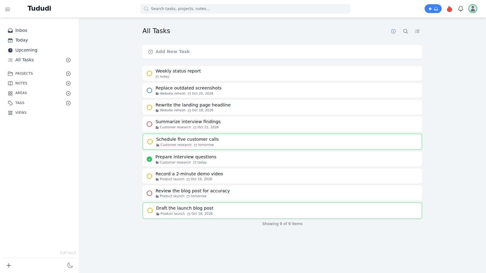
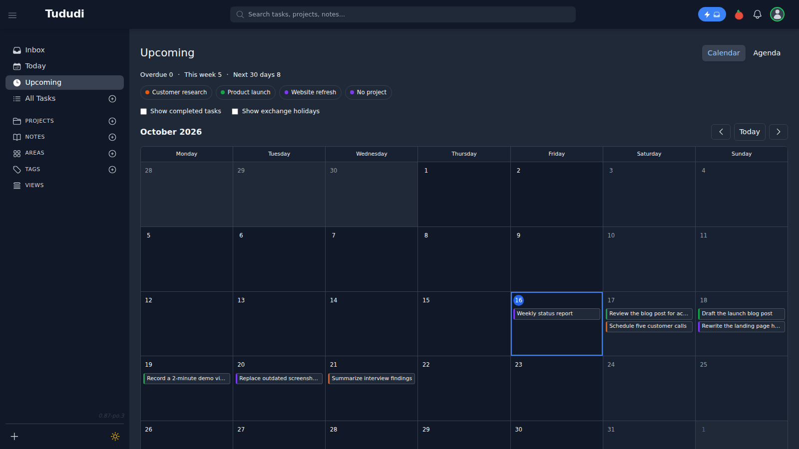
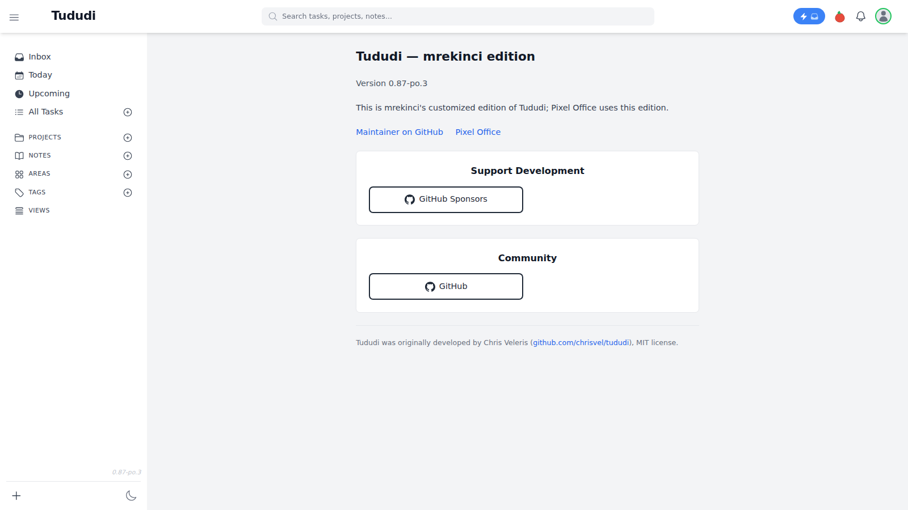

[English](README.md) | **Türkçe**

# Tududi — mrekinci sürümü

`pixel-office-tududi`, Tududi v0.87 temelinde hazırlanmış bağımsız bir çataldır. Paket ve Docker imajı sürümü `0.87-po.4` olarak yayımlanır; uygulamanın adı **Tududi** olarak kalır.

[Piksel Ofis](https://github.com/mrekinci-com/pixel-office), ajanların görevlerini, projelerini ve notlarını bu uygulamada tutar. [Bu depo](https://github.com/mrekinci-com/pixel-office-tududi) yalnız iş defterini içerir; ofis paneli ve ajan çalıştırıcıları ayrı projededir. Tek başına görev yönetimi için de kullanılabilir. Orijinal proje [Chris Veleris / Tududi](https://github.com/chrisvel/tududi) adresindedir.

## Ekran görüntüleri

Yalnız örnek veriler.







## Orijinal sürümden farklar

- Yaklaşan görevlerde 90 günlük pencere, aylık takvim ve gündem görünümleri; proje süzme ve görev tarihini sürükleyerek değiştirme.
- Gün başlıkları ve görev tarihleri uygulama dili ile kullanıcının saat dilimini izler.
- Notlarda sıralama; proje notlarında varsayılan olarak en yeni notun başta olması.
- Tamamlama halkasıyla görevi tamamlamadan veya yeniden açmadan önce onay.
- Yönetici API’sinde yalnız şifre gönderilerek yapılan değişikliklerin veritabanına kaydedilmesi.
- Kısmi görev güncellemelerinde durumun korunması: yalnız adı, notu veya tarihi değiştirmek tamamlanmış görevi yeniden açmaz.
- Bildirim zilinde yalnız okunmamış kayıtlar; okundu bilgisinin doğru gösterilmesi. Tamamlanan, arşivlenen veya silinen görevlerin ve ileri taşınan hatırlatmaların bildirimleri için düzeltmeler.
- İsteğe bağlı, sağlayıcıdan bağımsız dış panel kimlik kapısı; Piksel Ofis'in özel erişim davranışıyla uyumluluk.
- Bu sürüme ait Hakkında sayfası, Türkçe ve İngilizce metinler.

Kişisel terminal, komut çalıştırma paneli, terminal vekili, terminale ait pano/görsel aktarımı ve kişisel markalama bu sürümde bulunmaz. Mevcut veri modeli, yönetici API'si, API anahtarları ve görev/not/proje uçları korunur. Ayrıntılı bağlantı sözleşmesi [Uyumluluk sözleşmesi](docs/PIXEL-OFFICE-COMPATIBILITY.md) dosyasındadır.

## Docker ile kurulum

Node.js 22 tabanlı imajı bu depodan derleyin:

```sh
docker build -t pixel-office-tududi:0.87-po.4 .
cp .env.example .env
openssl rand -hex 64
```

`.env` içindeki yönetici e-postasını ve şifresini değiştirin. Son komutun ürettiği değeri `TUDUDI_SESSION_SECRET` alanına yazın; bu dosyayı paylaşmayın. Ardından:

```sh
docker compose up -d
```

Tarayıcıda `http://localhost:3002` adresini açın. Compose portu yalnız yerel arayüzde yayımlar. Veritabanı `./tududi_db`, yüklemeler `./uploads` dizininde saklanır. `PUID` ve `PGID` değerlerini gerekirse makinenizdeki dosya izinlerine göre değiştirin. Bu sürüm için hazır bir imaj kaydı varsayılmaz; Compose yerel imajı kullanır veya kaynaktan derler.

Piksel Ofis'e geçerken mevcut veritabanı ve yüklemeleri yedekleyin; yalnız imajı `pixel-office-tududi:0.87-po.4` olarak değiştirin. `PORT=9393`, ağ alanı paylaşımı, vekilin Host başlığı ve mevcut bağlama ayarları için uyum belgesini izleyin. Bu depodaki örnek Compose, tek başına yerel kullanım içindir.

## Erişim ayarları

- `TUDUDI_ALLOWED_ORIGINS`: tarayıcıdan izin verilen kökenlerin virgülle ayrılmış listesi. CORS listesi, özel Host istisnasını genişletmez.
- `RATE_LIMIT_AUTH_MAX`: giriş sınırı; varsayılan 15 dakikada 5 deneme. Piksel Ofis, özel ağda çok sayıda ajan hesabı açıp kullandığı kopyada `300` verir.
- `PANEL_ACCESS_ENABLED` **tanımsızsa** standart Tududi oturumu/API anahtarı doğrulaması kullanılır.
- `PANEL_ACCESS_ENABLED=false`: Piksel Ofis ile geriye uyumlu **yalnız özel erişim** modu. `localhost`, `127.0.0.1` ve tam olarak `127.0.0.1:${PORT}` Host değerleri geçer. Diğer Host değerleri 503 alır. Bu bir ağ güvenlik duvarı değildir; uygulamayı yerel arayüze bağlayan Compose/vekil düzeniyle birlikte kullanılır.
- `PANEL_ACCESS_ENABLED=true`: dış panelde RS256 imzalı kimlik jetonu **ve** normal Tududi girişi gerekir. `PANEL_PUBLIC_ORIGIN` (HTTPS kökeni), `PANEL_ACCESS_ISSUER`, `PANEL_ACCESS_AUD`, `PANEL_ACCESS_JWKS_URL` (HTTPS anahtar adresi), `PANEL_OWNER_EMAIL` (küçük harfli tam e-posta) birlikte tanımlanır. Kimlik jetonu `x-panel-access-token` başlığından alınır; farklı başlık için `PANEL_ACCESS_TOKEN_HEADER` ayarlanabilir. Jetonda `exp`, `iat`, `sub`, `email`, doğru issuer/audience ve sahip e-postası aranır. Vekil `X-Forwarded-Proto: https` iletir. Hatalı/eksik ayar dış erişimi kapatır; yerel istisna çalışmaya devam eder. Dış erişimde kayıt/e-posta doğrulama uçları kapalıdır.

Dış panel özelliği hiçbir kişisel alan adına, IP'ye veya kimlik sağlayıcısının özel uçlarına bağlı değildir. Yeni bir dış panel kurulumunda kendi HTTPS kimlik vekilinizi ve imzalı jeton ayarlarınızı kullanın. Özel erişimde vekil, yönlendirme/kimlik başlıklarını taşımadan tam yerel Host değerini göndermelidir; Piksel Ofis vekili bunu zaten yapar.

## Hakkında yapılandırması

Bu, [mrekinci](https://github.com/mrekinci-com) tarafından kendi kullanımı için özelleştirilmiş Tududi sürümüdür; [Piksel Ofis](https://github.com/mrekinci-com/pixel-office) de bu sürümü kullanır. Kimlik ve bağlantılar `frontend/config/edition.ts` dosyasında tutulur. Hakkında sayfasındaki Geliştirmeyi Destekle kutusu GitHub Sponsors, Topluluk kutusu GitHub profili bağlantısını gösterir. İlgili bağlantı listesi boşsa kutu görünmez. Yapılandırma değişikliklerinden sonra ön yüz yeniden derlenir.

## Geliştirme ve doğrulama

```sh
npm ci
NODE_ENV=production npm run frontend:build
npm run backend:build
npm run lint
npm run backend:test -- --runInBand
npm run backend:test:panel
npm run frontend:test -- --runInBand
```

Arka uç doğrudan JavaScript çalıştırır; ayrı bir dönüştürme/çıktı üretme aşaması yoktur. `backend:build`, sunucuyu başlatmadan üretim JavaScript kaynaklarının Node sözdizimi denetimini yapar. Jest testleri geçici test veritabanları kullanır. Dış panel testleri gerçek RSA imzalarıyla, ağ sunucusu açmadan çalışır. Playwright uçtan uca test betikleri servis başlatır; yalnız buna izin verilen ortamda çalıştırılmalıdır.

Varsayılan kullanıcı dili ve ön yüz yedek dili İngilizcedir. Mevcut dil tercihleri ve tarayıcı dili algılama davranışı korunur.

## Lisans ve atıf

MIT lisansı. Tududi'nin orijinal geliştiricisi Chris Veleris'tir. `LICENSE` içindeki `Copyright 2024, 2025 Tududi Developers` bildirimi korunmuştur; uyarlama için `Copyright (c) 2026 mrekinci` eklenmiştir. Dağıtımda lisans metni ve telif bildirimleri korunur; Docker imajı da `/app/LICENSE` dosyasını içerir.
